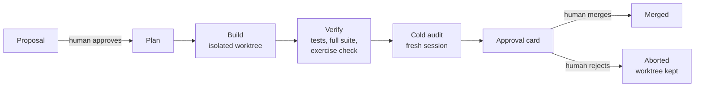
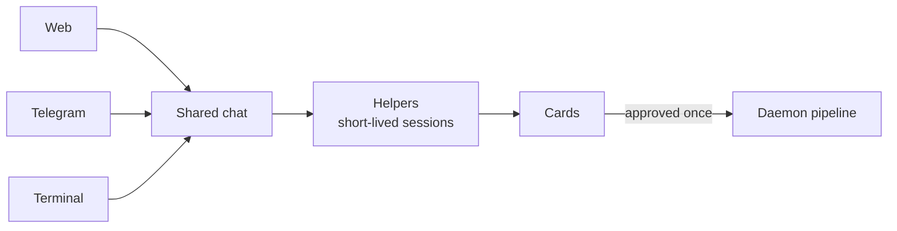

<div align="center">

# Navigator

**An AI coding agent that plans, builds and verifies a change, then stops for a human decision.**


</div>

Navigator is built to be safe to leave running. It never merges on its own by default
(one opt-in exception for docs/tests-only changes), confines the builder to an isolated
worktree, and has a fresh reviewer audit safety-relevant work before you see it.

Source is visible for review and feedback during a short window. Please read [Status](#status)
before judging it as a product. Screenshots: on request (the live console can show private chat).

## How it works



The conductor is the front door: one shared conversation, several ways in.



## How a change flows

A concrete example: "`parse_config` crashes on an empty file."

1. The planner reads the repo and files a **proposal**: title, affected files
   (`config.py`, `tests/test_config.py`) and a rationale. It sees about three at a time.
2. You approve it from the web page, Telegram or the CLI. Nothing has been written yet.
3. The builder creates a **per-run git worktree** and writes only the files the proposal names,
   with a checkpoint commit per phase.
4. The verifier runs the allowlisted test commands. The new test is also run against the base
   commit and must **fail** there, so it proves it exercises the fix.
5. The full suite runs, and empty diffs count as failures.
6. Because the change touches code, a **cold audit** by a fresh session re-reviews the diff.
   Findings are fixed before the run is offered to you.
7. You get an **approval card** showing the diff, risk tier (here B) and verification result.
8. You merge it, or reject it. Rejection keeps the worktree for inspection.

## Features

| Area | What it does |
| --- | --- |
| Gates | Two human decisions: approve the proposal, then approve the merge |
| Risk tiers | **A** tests/docs, **B** everything else, **C** money, auth, secrets, migrations, dependencies and Navigator's own safety code. Unknown is stricter |
| Scope | Builder may only write files the approved proposal names, inside a per-run worktree |
| Commands | Argv-only allowlist: no shell, no metacharacters, no absolute paths. Confinement by allowlist, **not** an OS sandbox |
| Self-checks | Tests run; new tests must fail on the base commit; empty diffs fail |
| Approval cards | Gated actions (merge, push, rebase, settings edits, costly builds) are denied until one card for that exact call is approved. It covers one call and expires |
| Cold audits | Safety-relevant changes are re-reviewed by a session that did not write them |
| Budget | Per-run duration, failed-test and tool-failure limits; dollar budget checked before each LLM call; capped daily credits fallback, only after a probe confirms the subscription is exhausted |
| Tier-A auto-merge | Opt-in (`NAVIGATOR_MERGE_TIER_A_AUTO=1`), off by default; tests/docs-only changes with green verification |

## Components

1. **Daemon pipeline** (`navigator/runtime`). Each cycle: expire stale proposals, plan,
   execute approved work, act on merge decisions. A *planner* proposes work, a *builder*
   writes it in a worktree with a checkpoint commit per phase, a *verifier* runs the allowlisted
   tests and checks. Failed runs keep their worktree for inspection. Proposals are ranked so the
   operator sees about three at a time.
2. **Conductor** (`navigator/conductor`). One shared conversation reachable from a web page,
   Telegram or your own terminal (the terminal joins the same session). It holds the gate,
   approval cards, build filing (it files specs with the daemon but never merges or declines),
   optional autopilot through a plan file (off by default, capped, quiet hours) and the credits fallback.
3. **Helpers** (`conductor/helpers.py`). The conversation turn only talks and delegates;
   long work (builds, audits) runs as separate short-lived sessions on a cheaper model with a
   write fence, and each reports back as a message. A registry survives restarts so lost helpers
   are reported.
4. **Site checker** (`navigator/checker`). Drives a browser through a web console, records
   faults and files fixes as proposals into the same gated pipeline.

## Shadow-mode results

Navigator replayed real historical bug fixes from the public
[more-itertools](https://github.com/more-itertools/more-itertools) repo. It saw the issue text
at the parent commit, never merged or pushed, and was scored against upstream tests it could not see.

| Measure | Result |
| --- | --- |
| Distinct replays (more-itertools) | 19 |
| Correct | **15 of 19** |
| Misses from ambiguous issue text | 2 (only the hidden upstream tests could see the expected behaviour) |
| Honest fails | 2 (Navigator's own checks failed and it rolled back) |
| Broken work passed that its own checks could have caught | 0 |
| Fix size | In several replays the source change was identical or near-identical to the upstream fix; after tuning, tests go into the existing test file |

Caveats: small sample, one repository, a library with a fast and strong test suite, and the
tuning happened on the same replays it was then re-run on. Treat this as a smoke signal, not a benchmark.

## Status

A personal project with a single operator, built for macOS and run under launchd. Several
paths and service labels are hard-coded to that setup. **Not production-ready**: no multi-user
model, no OS-level sandbox, and APIs and file formats change without notice.

## Running the tests

```bash
uv sync --extra sdk
uv run pytest -q     # deterministic: no network, no API key, fake ACT and fake LLM
```

Running the daemon for real needs a Claude subscription or API key and an ACT instance; see
[docs/RUNBOOK.md](docs/RUNBOOK.md) (operator commands, Telegram reader, configuration) and
`navigator.toml.example`. The code default is the safe profile: fake driver + dry run.

## Feedback wanted

1. **Gates:** are "two human decisions" plus risk tiers the right amount of friction? What would
   make you trust an agent enough to turn on tier-A auto-merge, or not?
2. **Verification:** the "new tests must fail on the base commit" check is meant to catch fake
   tests. What other cheap self-checks would you add?
3. **Evaluation:** is replaying historical fixes against hidden upstream tests a fair way to
   measure this? What repos or task types would make the numbers more convincing?
4. **Safety holes:** where would you attack the allowlist, scope check or approval cards first?

Open an issue, or comment wherever you found this. The repo is public for 48 hours.

## License

Copyright (c) 2026 Manoj Kothapalli. All rights reserved. Navigator is a product, not open
source. Source is visible for review and feedback only; no license to use, copy, modify or
distribute is granted. See [LICENSE.md](LICENSE.md).

## Layout

```
navigator/   config, cli, contracts/, clients/, safety/, runtime/, conductor/, checker/, observability/
tests/       mirrors the package; tests/test_e2e.py drives the full operator journey
deploy/      launchd plist templates
docs/        RUNBOOK.md (operator runbook)
```
